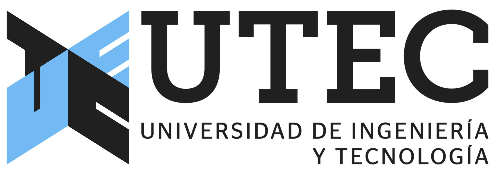
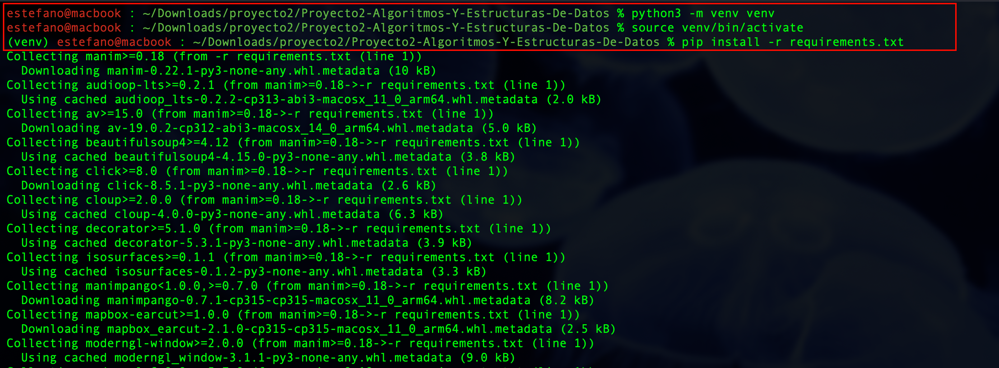

# Proyecto2-Algoritmos-Y-Estructuras-De-Datos

Proyecto 2 · CS2023 Algoritmos y Estructuras de Datos · UTEC



**Profesor:** 
- Luciano A. Romero Calla

**Autores:** 
- Estefano Zárate  100%

## Temas explicados en el avance

- Definición de centroide de un árbol
- Ejemplo de un nodo que no es centroide y otro que sí
- Teorema: todo árbol tiene 1 o 2 centroides
- Cálculo de tamaños de subárbol con DFS iterativo
- Búsqueda del centroide bajando hacia el hijo más pesado
- Complejidad O(n) frente al método ingenuo O(n²)

## Proceso de compilación del video
### Creando entorno virtual para instalar la libreria manim
```bash
python3 -m venv venv
source venv/bin/activate
pip install -r requirements.txt
```

