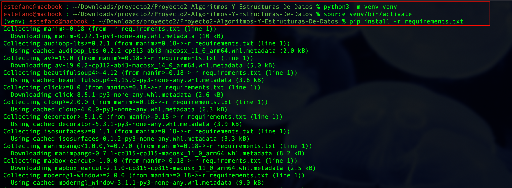
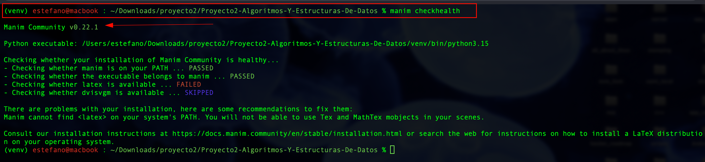
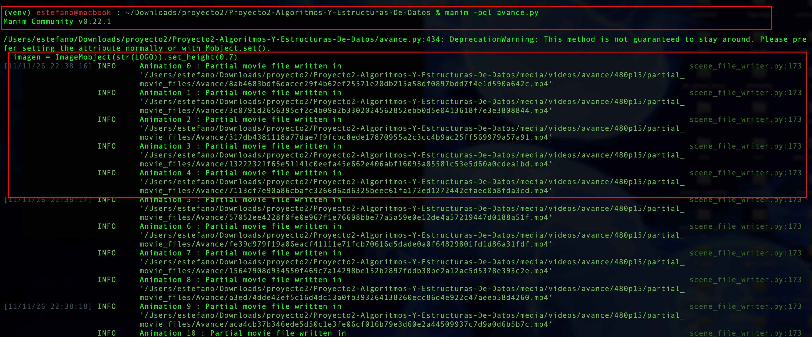
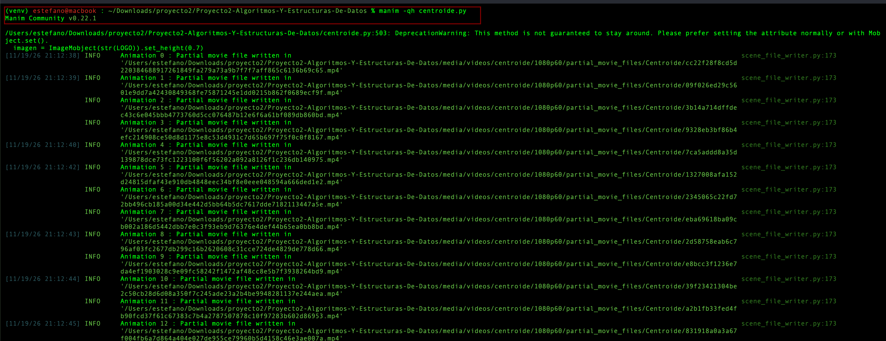
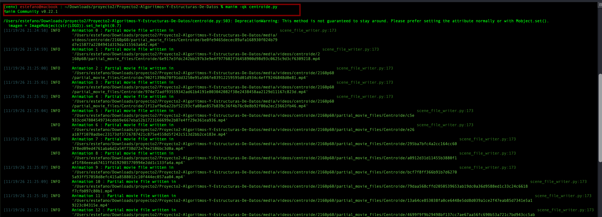
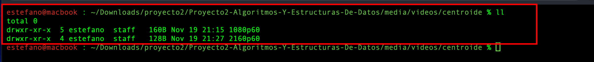

# Proyecto2-Algoritmos-Y-Estructuras-De-Datos

Proyecto 2 · CS2023 Algoritmos y Estructuras de Datos · UTEC


**Profesor:** 
- Luciano A. Romero Calla

**Autores:** 
- Estefano Zárate  100%

## Temas explicados en el avance

- Definición de centroide de un árbol
- Ejemplo de un nodo que no es centroide y otro que sí
- Teorema: todo árbol tiene 1 o 2 centroides
- Cálculo de tamaños de subárbol con DFS iterativo
- Búsqueda del centroide bajando hacia el hijo más pesado
- Complejidad O(n) frente al método ingenuo O(n²)

## Proceso de compilación del video
### Creando entorno virtual para instalar la libreria manim
```bash
python3 -m venv venv
source venv/bin/activate
pip install -r requirements.txt
```


### Verificando la instalación de la libreria manim
```bash
manim checkhealth   
```



### Compilando el video de avance
```bash
manim -pql avance.py   
```


### Compilando el video final en el script centroide.py
#### Compilando en la version 1080p60 y pesa 15.8MB
```bash
manim -qh centroide.py
```


#### Compilando en la version 4K y pesa 30MB
```bash
manim -qk centroide.py	
```



### Ruta de destino del video final compilado en 1080 y 4k una vez compilados
`/media/videos/avance/480p15 Avance.mp4` 


### Enlace Google Drive
[https://drive.google.com/drive/u/1/folders/1kq5q-x9SgnoZ_4p1PYKdoprF2lasUrGo](Drive)


